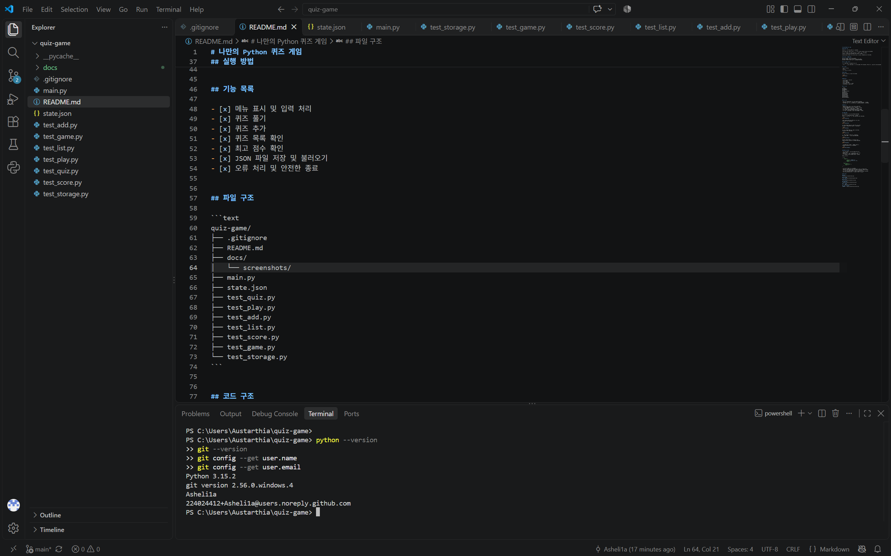
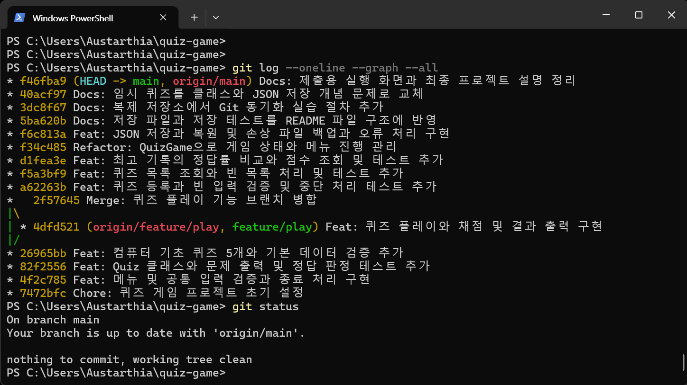
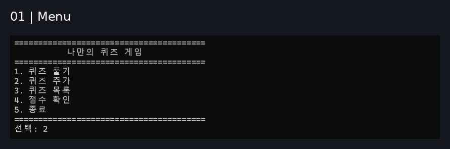
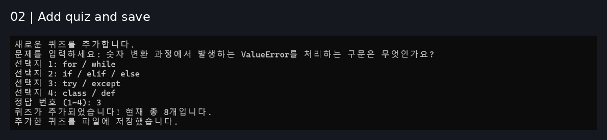
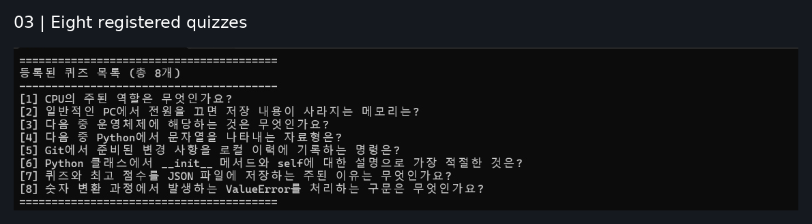
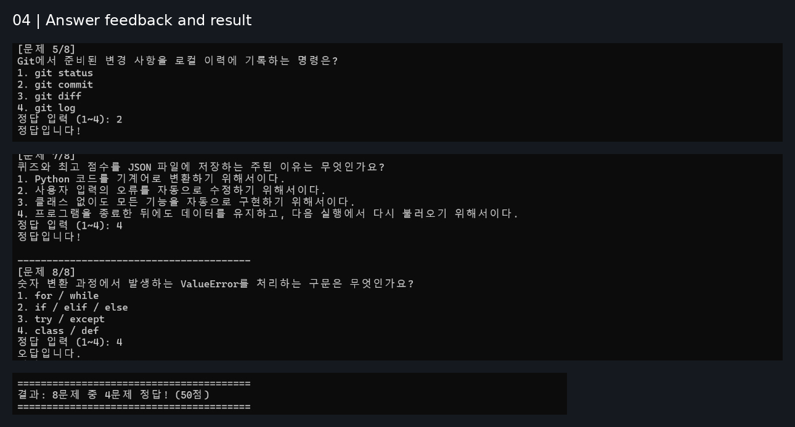
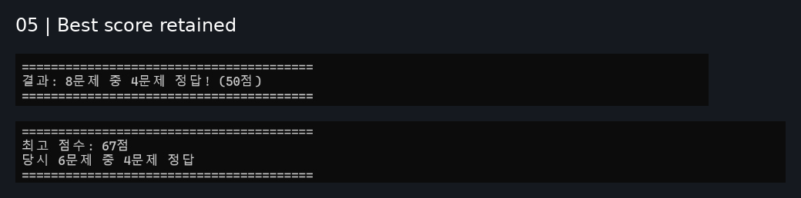
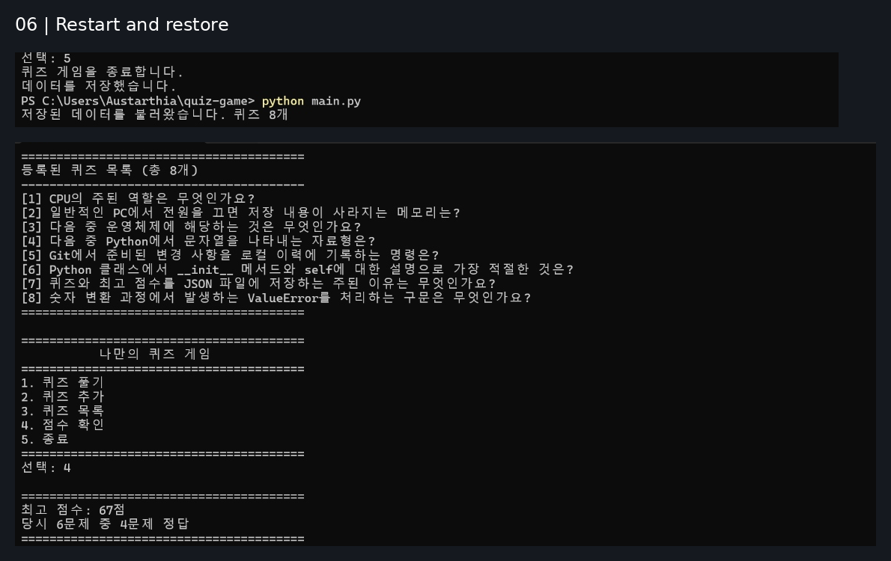

# 나만의 Python 퀴즈 게임

## 프로젝트 개요

Python으로 만드는 터미널 기반 퀴즈 게임입니다.

Python 기본 문법, 클래스, JSON 파일 저장, Git과 GitHub 사용법을 학습하는 프로젝트입니다.

메뉴, 퀴즈 플레이, 퀴즈 추가, 목록 조회, 최고 점수 관리를 구현했습니다. 보너스 기능으로 랜덤 출제, 문제 수 선택, 확인·취소를 지원하는 퀴즈 삭제, 점수 기록 히스토리, 힌트와 감점을 구현했습니다. 퀴즈·힌트·최고 기록·게임 기록을 프로젝트 루트의 state.json에 저장합니다.

Quiz와 QuizGame 클래스로 역할을 분리했으며, 파일 손상과 읽기·쓰기 오류를 처리합니다.


## Git 요구사항 증빙: 커밋 수·작업 단위·메시지 규칙

### 1. GitHub 업로드와 10개 이상 커밋 증빙

- 저장소: https://github.com/Asheli1a/02-python-first-steps
- 증빙 확인일: 2026-11-11
- 집계 기준: 원격 origin/main이 b3b2c01을 가리키던 시점
- 로컬 HEAD와 원격 origin/main: 모두 b3b2c01
- 원격 main 전체 이력: 39개 커밋
- 병합 제외 커밋: 33개
- 병합 커밋: 6개

최소 10개 이상 커밋 요구를 충족합니다. 단순히 개수만 제시하지 않고, 아래 작업별 커밋 대응표와 전체 로그로 변경 내용을 확인할 수 있도록 했습니다. 병합 제외 커밋에는 기능·수정·문서·관리 작업이 포함됩니다. 이를 전부 기능 구현 커밋이라고 집계하지 않습니다.

아래는 프로젝트 폴더에서 git fetch origin 후 직접 실행한 명령과 실제 출력입니다.

```text
PS C:\Users\Austarthia\quiz-game> git rev-parse --short HEAD
b3b2c01
PS C:\Users\Austarthia\quiz-game> git rev-parse --short origin/main
b3b2c01
PS C:\Users\Austarthia\quiz-game> git rev-list --count origin/main
39
PS C:\Users\Austarthia\quiz-game> git rev-list --count --no-merges origin/main
33
PS C:\Users\Austarthia\quiz-game> git rev-list --count --merges origin/main
6
```

위 39개는 b3b2c01까지의 고정된 증빙입니다. 이후 이 문서를 보완하는 커밋이 추가되면 최신 main의 수는 증가할 수 있습니다. 당시 수를 재확인하려면 다음처럼 기준 커밋을 지정합니다.

```powershell
git rev-list --count b3b2c01
git rev-list --count --no-merges b3b2c01
git rev-list --count --merges b3b2c01
git --no-pager log --oneline --reverse b3b2c01
```

원격 업로드도 별도로 확인했습니다. b3b2c01의 push 성공 후, 위 조회에서 HEAD와 origin/main이 일치했고 git status는 다음 상태였습니다.

```text
On branch main
Your branch is up to date with 'origin/main'.

nothing to commit, working tree clean
```

### 2. 커밋 작업 단위와 메시지 규칙

이 저장소는 메뉴·Quiz·기본 문제·플레이·등록·목록·점수·파일 저장·보너스 기능을 작업 단위로 나누어 기록했습니다. 기능의 검증 테스트는 해당 구현과 함께 커밋하고, 기능과 구분할 수 있는 가독성 변경이나 문서 정리는 별도 커밋으로 남겼습니다.

실제 사용한 메시지의 기본 형식은 다음과 같습니다.

```text
<접두사>: <무엇을 변경했는지 설명하는 요약>
```

| 접두사 | 구분 기준 | 실제 사용 예 |
|---|---|---|
| Feat | 새로운 기능·데이터 구현 | Feat: 메뉴 및 공통 입력 검증과 종료 처리 구현 |
| Fix | 오류 처리·검증·안내 개선 | Fix: 등록과 게임 결과의 저장 실패 안내 및 기록 검증 메시지 보완 |
| Refactor | 기능을 유지하는 구조·가독성 개선 | Refactor: 퀴즈 게임 코드의 긴 줄과 공백 정리 |
| Docs | 설명·실행 화면·검증 기록 등 문서 작업 | Docs: 저장 안내 개선의 병합과 원격 반영 및 최종 검증 기록 추가 |
| Chore | 초기 설정·관리 작업·검증 데이터 정리 | Chore: 퀴즈 게임 프로젝트 초기 설정 |
| Merge | 브랜치 병합 이력 | Merge: 저장 실패 안내와 코드 가독성 개선 병합 |

이는 실제 이력에서 사용한 형식의 정리이며, 자동 검사 도구나 커밋 훅으로 강제했다는 뜻은 아닙니다. 과거 커밋의 분류를 다시 쓰거나 이력을 변경하지 않았습니다.

작업 단위의 예로 저장 안내 개선은 5f33a8a(Fix와 관련 테스트), 37116de(Refactor), b077e47(Docs)로 분리했습니다. 가독성 정리는 기능 변경과 섞지 않고 AST 동일성과 회귀 테스트로 확인했습니다.

### 3. 요구 기능과 실제 커밋의 대응

아래는 10개를 넘는 구체적인 작업의 실제 커밋입니다. 각 링크에서 변경 파일과 내용을 확인할 수 있습니다.

| 작업 단위 | 실제 커밋 | 접두사 | 변경 내용 |
|---|---|---|---|
| 초기 설정 | [7472bfc](https://github.com/Asheli1a/02-python-first-steps/commit/7472bfc) | Chore | 프로젝트 초기 설정 |
| 메뉴·입력 | [4f2c785](https://github.com/Asheli1a/02-python-first-steps/commit/4f2c785) | Feat | 메뉴·입력 검증·종료 |
| Quiz 클래스 | [82f2556](https://github.com/Asheli1a/02-python-first-steps/commit/82f2556) | Feat | 문제 출력·정답 판정과 테스트 |
| 기본 문제 | [26965bb](https://github.com/Asheli1a/02-python-first-steps/commit/26965bb) | Feat | 컴퓨터 기초 퀴즈 5개 |
| 퀴즈 플레이 | [4dfd521](https://github.com/Asheli1a/02-python-first-steps/commit/4dfd521) | Feat | 출제·채점·결과 출력 |
| 퀴즈 등록 | [a62263b](https://github.com/Asheli1a/02-python-first-steps/commit/a62263b) | Feat | 등록·빈 입력·입력 중단 검증 |
| 퀴즈 목록 | [f5a3bf9](https://github.com/Asheli1a/02-python-first-steps/commit/f5a3bf9) | Feat | 목록·빈 목록 처리 |
| 최고 점수 | [d1fea3e](https://github.com/Asheli1a/02-python-first-steps/commit/d1fea3e) | Feat | 최고 기록 비교·점수 조회 |
| 클래스 구조 | [f34c485](https://github.com/Asheli1a/02-python-first-steps/commit/f34c485) | Refactor | QuizGame 책임 정리 |
| 파일 저장 | [f6c813a](https://github.com/Asheli1a/02-python-first-steps/commit/f6c813a) | Feat | JSON 저장·복원·손상 백업 |
| 복제 실습 | [3dc8f67](https://github.com/Asheli1a/02-python-first-steps/commit/3dc8f67) | Docs | 복제본에서 변경·커밋·원격 반영 |
| 랜덤 출제 | [76802e2](https://github.com/Asheli1a/02-python-first-steps/commit/76802e2) | Feat | 출제 수 선택·무작위 선정 |
| 퀴즈 삭제 | [6f70633](https://github.com/Asheli1a/02-python-first-steps/commit/6f70633) | Feat | 삭제·저장·검증 |
| 게임 기록 | [8a9b642](https://github.com/Asheli1a/02-python-first-steps/commit/8a9b642) | Feat | 히스토리·기존 파일 호환 |
| 힌트 기반 | [df1995b](https://github.com/Asheli1a/02-python-first-steps/commit/df1995b) | Feat | 힌트 속성·저장 호환 |
| 힌트 플레이 | [ba0f74b](https://github.com/Asheli1a/02-python-first-steps/commit/ba0f74b) | Feat | 요청·감점·설정 메뉴 |
| 저장 안내 | [5f33a8a](https://github.com/Asheli1a/02-python-first-steps/commit/5f33a8a) | Fix | 저장 실패 안내·기록 검증·테스트 |
| 가독성 | [37116de](https://github.com/Asheli1a/02-python-first-steps/commit/37116de) | Refactor | 동작 유지·긴 줄·공백 정리 |

### 4. 브랜치 목적과 병합 이력

| 브랜치 | 목적 | main 병합 커밋 |
|---|---|---|
| feature/play | 필수 퀴즈 플레이 구현 | 2f57645 |
| feature/random-selection | 랜덤 출제·문제 수 선택 | 401ba5f |
| feature/delete-quiz | 퀴즈 삭제·저장 | 09d7092 |
| feature/history | 게임 기록 저장·조회 | 117f305 |
| feature/hints | 힌트 속성·요청·감점·설정 | 78ac669 |
| fix/storage-feedback | 저장 실패 안내·검증·가독성 개선 | 28654e7 |

실제 브랜치 이름은 새 기능에 feature/<작업명>, 수정에 fix/<작업명> 형식을 사용했습니다. 기능별 테스트 후 main에 --no-ff로 병합하고, 병합된 main에서 회귀 테스트와 작업 상태를 확인한 뒤 원격에 반영했습니다. PR·외부 리뷰를 필수 절차로 운영했다는 뜻은 아닙니다.

clone → 복제본 수정·commit·push → 원래 폴더에서 pull한 실제 명령과 출력은 아래 'Git 복제 및 동기화 실습' 절에 별도로 보존했습니다.

### 5. 원격 main 전체 커밋 로그

다음은 2026-11-11 원격 origin/main을 조회한 실제 전체 출력 39줄입니다. 브랜치 장식과 HEAD 표시는 b3b2c01 증빙 시점의 상태이며, 이후 변경될 수 있습니다.

```powershell
git --no-pager log --oneline --reverse origin/main
```

```text
7472bfc Chore: 퀴즈 게임 프로젝트 초기 설정
4f2c785 Feat: 메뉴 및 공통 입력 검증과 종료 처리 구현
82f2556 Feat: Quiz 클래스와 문제 출력 및 정답 판정 테스트 추가
26965bb Feat: 컴퓨터 기초 퀴즈 5개와 기본 데이터 검증 추가
4dfd521 (origin/feature/play, feature/play) Feat: 퀴즈 플레이와 채점 및 결과 출력 구현
2f57645 Merge: 퀴즈 플레이 기능 브랜치 병합
a62263b Feat: 퀴즈 등록과 빈 입력 검증 및 중단 처리 테스트 추가
f5a3bf9 Feat: 퀴즈 목록 조회와 빈 목록 처리 및 테스트 추가
d1fea3e Feat: 최고 기록의 정답률 비교와 점수 조회 및 테스트 추가
f34c485 Refactor: QuizGame으로 게임 상태와 메뉴 진행 관리
f6c813a Feat: JSON 저장과 복원 및 손상 파일 백업과 오류 처리 구현
5ba620b Docs: 저장 파일과 저장 테스트를 README 파일 구조에 반영
3dc8f67 Docs: 복제 저장소에서 Git 동기화 실습 절차 추가
40acf97 Docs: 임시 퀴즈를 클래스와 JSON 저장 개념 문제로 교체
f46fba9 Docs: 제출용 실행 화면과 최종 프로젝트 설명 정리
dd49d32 Docs: 개발 환경과 Git 증빙 추가 및 플레이 화면 잘림 보완
c0b0223 Docs: clone과 pull 실습의 실제 실행 로그 추가
ef4b747 Docs: 학습 목표 개념 설명과 실습 로그 URL 표기 정리
3e14ee7 Docs: 클래스와 JSON 선택 이유 및 데이터 확장 한계 정리
76802e2 (origin/feature/random-selection, feature/random-selection) Feat: 랜덤 출제와 문제 수 선택 및 실제 출제 수 기준 기록 구현
401ba5f Merge: 랜덤 출제와 문제 수 선택 기능 병합
4cb22b2 Docs: 랜덤 출제 검증 로그와 점수 정책 및 테스트 구조 보완
6f70633 (origin/feature/delete-quiz, feature/delete-quiz) Feat: 퀴즈 삭제와 저장 및 검증 문서 구현
09d7092 Merge: 퀴즈 삭제 기능 병합
31992c8 Docs: 퀴즈 삭제 기능의 병합과 원격 반영 기록 추가. 줄바꿈 정리
8a9b642 Feat: 게임 기록 히스토리와 기존 파일 호환 및 검증 문서 구현
3d9289d (origin/feature/history, feature/history) Chore: 히스토리 검증 기록과 최고 점수 저장 데이터 반영
117f305 Merge: 점수 기록 히스토리 기능 병합
96e6d96 Docs: 히스토리 기능의 병합과 저장 데이터 반영 기록 추가
c71db24 Docs: QuizGame 설명에 게임 기록 관리 역할 반영
df1995b Feat: 힌트 속성과 기존 데이터 호환 및 저장 검증 추가
ba0f74b (origin/feature/hints, feature/hints) Feat: 힌트 요청과 감점 및 설정 메뉴와 기록 호환 구현
78ac669 Merge: 힌트 요청과 감점 및 설정 기능 병합
2ba31a4 Docs: 힌트 기능 병합과 원격 반영 및 최종 검증 기록 추가
5f33a8a Fix: 등록과 게임 결과의 저장 실패 안내 및 기록 검증 메시지 보완
37116de Refactor: 퀴즈 게임 코드의 긴 줄과 공백 정리
b077e47 (origin/fix/storage-feedback, fix/storage-feedback) Docs: 저장 실패 안내와 가독성 개선 및 13종 테스트 검증 기록 추가
28654e7 Merge: 저장 실패 안내와 코드 가독성 개선 병합
b3b2c01 (HEAD -> main, origin/main, origin/HEAD) Docs: 저장 안내 개선의 병합과 원격 반영 및 최종 검증 기록 추가
```

## Git 복제 및 동기화 실습

별도 로컬 폴더에 저장소를 복제한 뒤 README를 수정하여 commit과 push를 수행했습니다. 이후 원래 작업 폴더에서 pull로 변경을 가져와 반영 여부를 확인했습니다.

아래는 실제 터미널 실행 기록의 핵심 부분입니다. 객체 전송 진행률 등 일부 출력은 생략했습니다.

### 1. 별도 폴더에 저장소 복제

<details>
<summary>clone 실행 기록</summary>

```text
PS C:\Users\Austarthia> git clone https://github.com/Asheli1a/02-python-first-steps.git quiz-game-clone
Cloning into 'quiz-game-clone'...
```

객체 수신과 델타 처리가 완료된 뒤 복제 폴더로 이동했습니다.

```text
PS C:\Users\Austarthia> cd .\quiz-game-clone
PS C:\Users\Austarthia\quiz-game-clone> Get-Location

Path
----
C:\Users\Austarthia\quiz-game-clone

PS C:\Users\Austarthia\quiz-game-clone> git log --oneline -3
5ba620b (HEAD -> main, origin/main, origin/HEAD) Docs: 저장 파일과 저장 테스트를 README 파일 구조에 반영
f6c813a Feat: JSON 저장과 복원 및 손상 파일 백업과 오류 처리 구현
f34c485 Refactor: QuizGame으로 게임 상태와 메뉴 진행 관리
```

</details>

### 2. 복제본에서 README 수정 후 commit·push

<details>
<summary>복제본의 변경 기록</summary>

복제본에서 Git 작성자 설정을 완료하고 README를 수정했습니다.

```text
PS C:\Users\Austarthia\quiz-game-clone> git add README.md
PS C:\Users\Austarthia\quiz-game-clone> git commit -m "Docs: 복제 저장소에서 Git 동기화 실습 절차 추가"
[main 3dc8f67] Docs: 복제 저장소에서 Git 동기화 실습 절차 추가
 1 file changed, 8 insertions(+)
```

이어서 원격 main 브랜치에 업로드했습니다. 다음은 push 명령과 성공 결과입니다.

```text
PS C:\Users\Austarthia\quiz-game-clone> git push origin main
To https://github.com/Asheli1a/02-python-first-steps.git
   5ba620b..3dc8f67  main -> main
```

</details>

### 3. 원래 작업 폴더에서 pull

<details>
<summary>pull 실행 기록과 반영 확인</summary>

원래 작업 폴더로 돌아와 원격 변경을 가져왔습니다. 다음은 pull 명령과 주요 결과입니다.

```text
PS C:\Users\Austarthia\quiz-game-clone> cd C:\Users\Austarthia\quiz-game
PS C:\Users\Austarthia\quiz-game> git pull --ff-only origin main
```

```text
Updating 5ba620b..3dc8f67
Fast-forward
 README.md | 8 ++++++++
 1 file changed, 8 insertions(+)
```

원래 폴더의 이력에도 복제본에서 만든 커밋이 반영됐습니다. 당시 git log 출력의 첫 줄은 다음과 같습니다.

```text
* 3dc8f67 (HEAD -> main, origin/main) Docs: 복제 저장소에서 Git 동기화 실습 절차 추가
```

최종 작업 상태도 확인했습니다.

```text
PS C:\Users\Austarthia\quiz-game> git status
On branch main
Your branch is up to date with 'origin/main'.

nothing to commit, working tree clean
```

</details>

### 실습 결과

- clone으로 원격 저장소를 별도 폴더에 복제했습니다.
- 복제본에서 README를 수정하고 커밋 3dc8f67을 생성했습니다.
- push로 해당 커밋을 원격 main에 반영했습니다.
- 원래 폴더에서 pull하여 5ba620b에서 3dc8f67로 갱신했습니다.
- README 8줄의 반영과 원격 브랜치 동기화를 확인했습니다.

위 기록은 실습 당시의 상태이며, 이후 기능·문서 정리 커밋이 추가되었습니다.


## 퀴즈 주제와 선정 이유

주제: 컴퓨터 기초 및 Python·Git 학습 개념

선정 이유: 관심 있는 컴퓨터 기초 지식과 이번 미션에서 배운 Python·Git 개념을 퀴즈로 만들며 학습 내용을 복습하기 위해 선정했습니다.


## 개발 환경

- Python 3.10 이상
- Git
- VS Code
- 외부 라이브러리 사용 없음


### 요구 환경과 실제 검증 환경

| 구분 | 환경·상태 |
|---|---|
| 미션 요구 환경 | Python 3.10 이상, 외부 라이브러리 없이 실행 |
| 실제 검증 운영체제 | Windows, PowerShell 터미널 |
| 실제 검증 Python | CPython 3.15.2, 64비트 |
| 설치 버전 조회 | py --list에서 Python 3.15.2 하나 확인 |
| Python 3.10 실행 검증 | 현재 환경에 설치돼 있지 않아 미검증 |

Python 3.10 이상을 대상으로 작성했지만, 모든 3.10 이상 버전에서 테스트했다는 뜻은 아닙니다. 현재 실제 실행 근거는 아래 Python 3.15.2 결과입니다. Python 3.10 검증은 해당 버전이 있는 환경에서 동일한 테스트를 실행한 뒤에만 추가합니다.

실제 조회 명령:

```powershell
python --version
python -c "import sys; print(sys.executable); print(sys.version)"
py --list
```

확인된 Python 버전과 실행 파일:

```text
Python 3.15.2
C:\Users\Austarthia\AppData\Local\Python\pythoncore-3.15-64\python.exe
```

## 실행 방법

프로젝트 폴더에서 다음 명령어를 실행합니다.

```bash
python main.py
```


## 기능 목록

### 현재 메뉴

```text
1. 퀴즈 풀기
2. 퀴즈 추가
3. 퀴즈 목록
4. 점수 확인
5. 종료
6. 퀴즈 삭제
7. 게임 기록
8. 힌트 설정
```

1번에서는 출제할 문제 수를 선택하고, 답안 입력 중 h 또는 H로 힌트를 요청할 수 있습니다. 6번에서는 삭제할 문제와 최종 확인을 입력합니다. 7번에서는 완료한 게임 기록을 최근 기록부터 확인하며, 8번에서는 기존 문제의 힌트를 설정·변경·제거합니다. 5번 종료는 기존과 동일합니다.


- [x] 메뉴 표시 및 입력 처리
- [x] 퀴즈 풀기
- [x] 퀴즈 추가
- [x] 퀴즈 목록 확인
- [x] 최고 점수 확인
- [x] JSON 파일 저장 및 불러오기
- [x] 오류 처리 및 안전한 종료


## 파일 구조

```text
quiz-game/
├── .gitignore
├── README.md
├── docs/
│   └── screenshots/
├── main.py
├── run_tests.py
├── state.json
├── test_quiz.py
├── test_play.py
├── test_add.py
├── test_list.py
├── test_score.py
├── test_game.py
├── test_storage.py
├── test_random_selection.py
├── test_delete.py
├── test_history.py
├── test_hints.py
├── test_hint_play.py
└── test_storage_feedback.py
```


## 코드 구조

- Quiz: 문제 하나의 데이터, 출력, 정답 확인을 담당합니다.
- QuizGame: 퀴즈 목록, 최고 기록, 게임 기록을 보관하고 메뉴와 게임 진행을 관리합니다.
- 공통 함수: 입력 검증과 개별 기능 처리를 담당하며 QuizGame에서 재사용합니다.


### 주요 메서드와 책임 경계

| 대상 | 함수·메서드 | 책임 |
|---|---|---|
| Quiz | display(), check_answer() | 개별 문제 출력과 정답 판정 |
| QuizGame | run(), show_menu() | 메뉴와 기능 연결 |
| QuizGame | play_selected(), play() | 출제 대상 선정·게임 결과·최고 기록·히스토리 관리 |
| QuizGame | add_quiz(), delete_quiz(), set_hint() | 문제·힌트 변경과 저장 결과 안내 |
| QuizGame | show_quiz_list(), show_best_score(), show_history() | 목록·최고 기록·누적 기록 조회 |
| QuizGame | load_state(), save_state(), backup_damaged_state() | 파일 읽기·쓰기·손상 백업·원본 보호 |
| 공통 함수 | input_int(), input_text(), input_answer() | 사용자 입력·재입력·힌트 요청 처리 |
| 공통 함수 | parse_state(), parse_history() | 저장 데이터의 구조·형식·값 검증 |
| 공통 함수 | score_value(), score_from_record(), update_best_score() | 감점 후 점수 계산과 최고 기록 비교 |

입력 검증은 사용자 입력을 올바른 값으로 받는 책임이고, 저장 데이터 검증은 JSON을 게임 데이터로 받아들일 수 있는지 검사하는 책임입니다. 영속화는 이 데이터를 파일에 읽고 쓰는 책임이며, QuizGame이 게임 상태 변경 후 저장을 연결합니다.

## 학습 목표와 구현 연결

이 프로젝트에서 사용한 Python과 Git 개념을 실제 코드와 연결해 정리했습니다.

### 1. 변수와 자료형

변수는 객체에 이름을 붙여 값을 참조하고 재사용하기 위한 수단입니다. Python에서 이름은 객체를 참조하며, 자료형은 객체에 속합니다.

예를 들어 correct_count는 이번 게임의 정답 수를 관리합니다.

```python
correct_count = 0
correct_count += 1
```

주요 자료형의 용도는 다음과 같습니다.

| 자료형 | 의미 | 프로젝트 예시 |
|---|---|---|
| int | 정수 | 정답 번호, 정답 수 |
| str | 문자열 | 문제, 선택지, 사용자 입력 |
| bool | 참 또는 거짓 | 정답 판정, 저장 성공 여부 |
| list | 순서가 있고 수정 가능한 목록 | 퀴즈 목록, 선택지 목록 |
| dict | 키와 값으로 구성하는 자료구조 | 최고 기록, JSON 저장용 데이터 |

input()의 반환값은 문자열입니다. 따라서 숫자 비교가 필요한 곳에서는 int()로 변환합니다.

```python
text = input("정답: ").strip()
number = int(text)
```

변환할 수 없는 문자열이면 ValueError가 발생하므로 프로그램에서는 try/except로 처리합니다.

None은 bool이나 숫자 0과 다른 값이며, 이 프로젝트에서는 '아직 기록 없음' 또는 '게임을 진행하지 않음'을 나타냅니다.

```python
if correct_count is not None:
    # 0개 정답도 완료한 게임으로 기록합니다.
    ...
```

### 2. 조건문: if / elif / else

조건에 따라 서로 다른 코드를 실행할 때 사용합니다. 하나의 if/elif/else 묶음에서는 처음 참이 되는 분기를 실행합니다.

이 프로젝트에서는 선택한 메뉴에 따라 실행할 기능을 결정합니다.

```python
if choice == 1:
    self.play_selected()
elif choice == 2:
    self.add_quiz()
else:
    ...
```

정답 판정과 빈 목록 확인에도 조건문을 사용합니다.

### 3. 반복문: for와 while

for는 목록 등 반복 가능한 대상의 항목을 순서대로 처리할 때 사용합니다. while은 조건이 참인 동안 계속 반복할 때 사용합니다.

- for: 퀴즈 출제, 선택지 출력, 선택지 4개 입력
- while: 메뉴 반복, 올바른 입력을 받을 때까지 재입력

```python
for quiz in quizzes:
    quiz.display()
```

```python
while True:
    # 입력을 검사하고 필요하면 다시 입력받습니다.
    ...
```

break는 가장 가까운 반복문을 끝냅니다. continue는 현재 반복의 남은 부분을 건너뛰고 다음 반복으로 이동합니다.

### 4. 함수·매개변수·반환값

함수는 반복해서 사용할 동작에 이름을 붙인 것입니다. 동작을 나누면 재사용과 테스트가 쉬워집니다.

매개변수는 함수 정의에서 입력을 받는 이름이고, 인자는 함수를 호출할 때 전달하는 실제 값입니다. return은 결과를 돌려주고 해당 함수 실행을 끝냅니다.

```python
def input_int(prompt, minimum, maximum):
    ...
    return number

choice = input_int("선택: ", 1, 8)
```

위 코드에서 prompt, minimum, maximum은 매개변수이고, "선택: ", 1, 8은 전달한 인자입니다. 반환된 정수는 choice가 참조합니다.

명시적으로 값을 반환하지 않는 함수의 반환값은 None입니다.

### 5. 클래스와 객체

클래스는 관련 데이터와 동작을 묶는 정의입니다. 객체는 그 클래스를 사용해 만든 개별 인스턴스입니다.

- Quiz: 문제 하나의 데이터와 동작
- QuizGame: 퀴즈 목록, 최고 기록, 메뉴와 진행 흐름

```python
quiz = Quiz(
    question="두 번째 선택지를 고르세요.",
    choices=["A", "B", "C", "D"],
    answer=2,
)
```

Quiz는 클래스이고, quiz가 참조하는 값은 Quiz의 객체입니다.

여러 Quiz 객체는 같은 메서드 정의를 사용하지만, 각자의 문제·선택지·정답을 보관합니다.

### 6. __init__, self, 속성과 메서드

__init__은 일반적인 객체 생성 과정에서 초기 상태를 설정하는 메서드입니다. 객체 자체를 생성하는 역할과 초기화하는 역할은 엄밀히 구분됩니다.

self는 인스턴스 메서드가 전달받는 해당 객체 자신입니다. self라는 이름은 Python의 관례입니다.

```python
def __init__(self, question, choices, answer, hint=""):
    self.question = question
    self.choices = choices
    self.answer = answer
    self.hint = hint
```

속성은 객체가 보관하는 데이터이고, 메서드는 객체에 연결된 함수입니다.

- 속성: quiz.question, quiz.answer
- 메서드: quiz.display(), quiz.check_answer(2)

```python
quiz.display()
is_correct = quiz.check_answer(2)
```

QuizGame의 self.quizzes와 self.best_score도 인스턴스 속성입니다. 각 게임 객체는 독립된 상태를 보관합니다.

### 7. 파일 열기·읽기·쓰기

파일은 경로, 모드, 인코딩을 지정해 엽니다.

- r: 읽기
- w: 쓰기. 기존 파일이 있으면 내용을 비우므로 주의해야 합니다.
- encoding="utf-8": 한글을 일관된 인코딩으로 처리

with 문을 사용하면 해당 구역을 벗어날 때 파일을 닫습니다.

```python
with self.state_path.open("r", encoding="utf-8") as file:
    data = json.load(file)
```

이 프로젝트는 저장할 때 기존 state.json에 바로 쓰지 않고, 임시 파일에 작성한 뒤 교체합니다. 따라서 임시 파일 작성이나 교체가 실패하면 기존 파일을 보존할 수 있습니다.

강제 종료나 정전까지 저장 완료를 보장하는 것은 아닙니다.

### 8. JSON과 데이터 영속성

JSON은 객체, 배열, 문자열, 숫자 등을 표현하는 텍스트 기반 데이터 교환 형식입니다.

프로그램 메모리의 값은 종료 후 자동으로 복원되지 않으므로, 파일에 기록하고 다음 실행에서 읽어 데이터 영속성을 구현합니다.

- json.dump(): Python 데이터를 파일에 JSON으로 기록
- json.load(): 파일의 JSON을 Python 데이터로 읽기
- Python dict는 JSON 객체로, list는 JSON 배열로 표현
- Python None은 JSON null로 표현

Quiz 객체를 그대로 저장하는 대신 필요한 속성을 딕셔너리로 바꿔 저장합니다.

```python
{
    "question": quiz.question,
    "choices": quiz.choices,
    "answer": quiz.answer,
    "hint": quiz.hint,
}
```

불러올 때는 parse_state()로 자료형과 값의 범위를 검사한 뒤 다시 Quiz 객체를 만듭니다.

JSON 문법이 맞는 것과 게임 데이터로 유효한 것은 다릅니다. 선택지 개수나 정답 범위도 별도로 검사해야 합니다.

### 9. try / except와 안전한 종료

try는 오류가 발생할 수 있는 코드를 실행하고, except는 지정한 예외가 발생했을 때 실행할 처리를 정의합니다.

이 프로젝트의 주요 처리 대상은 다음과 같습니다.

| 예외 | 발생 상황 | 처리 |
|---|---|---|
| ValueError | 숫자 변환 실패, 데이터 검증 실패 | 재입력 또는 손상 처리 |
| FileNotFoundError | 저장 파일 없음 | 기본 퀴즈 사용 |
| OSError | 파일 접근·저장 오류 | 안내와 원본 보호 |
| KeyboardInterrupt | Ctrl+C | 안내 후 종료 및 저장 시도 |
| EOFError | 입력 스트림 종료 | 안내 후 종료 및 저장 시도 |

JSONDecodeError는 ValueError의 하위 예외이므로 저장 파일을 읽는 코드의 ValueError 처리에 포함됩니다.

finally는 예외 발생 여부와 관계없이 정리 코드를 실행할 때 사용합니다. 이 프로젝트에서는 종료 시 가능한 범위에서 저장을 시도합니다.

### 10. Git과 GitHub

Git은 파일 변경 이력을 로컬 저장소에 기록하고 관리하는 분산 버전 관리 도구입니다.

GitHub는 Git 저장소를 원격으로 보관하고 공유·협업할 수 있게 하는 서비스입니다.

commit은 로컬 기록이며, GitHub 업로드는 push로 수행합니다.

| 명령 | 역할 | 이 프로젝트에서의 사용 |
|---|---|---|
| git init | 현재 폴더를 Git 저장소로 초기화 | 프로젝트 시작 |
| git add | 다음 커밋에 넣을 변경을 스테이징 | 기능별 변경 선택 |
| git commit | 스테이징된 변경을 로컬 이력으로 기록 | 기능별 작업 기록 |
| git push | 원격 저장소에 로컬 커밋 반영 | GitHub 업로드 |
| git pull | 원격 변경을 가져와 현재 브랜치에 통합 | 복제본의 수정 가져오기 |
| git checkout | 브랜치 전환 등 | main과 feature/play 전환 |
| git clone | 저장소와 이력을 새 폴더에 복제 | 별도 폴더 실습 |
| git merge | 다른 브랜치의 변경을 현재 브랜치에 통합 | 플레이 기능 병합 |

git add 이후 파일을 다시 수정하면, 그 수정은 다시 add해야 다음 커밋에 포함됩니다.

### 11. 브랜치 생성과 병합

브랜치는 독립된 작업 흐름을 관리하기 위한 수단입니다. 이 프로젝트에서는 플레이 기능을 별도 브랜치에서 구현했습니다.

```bash
git checkout -b feature/play
```

기능 완성과 커밋 후 main으로 돌아와 병합했습니다.

```bash
git checkout main
git merge --no-ff feature/play -m "Merge: 퀴즈 플레이 기능 브랜치 병합"
```

--no-ff는 fast-forward가 가능한 경우에도 병합 커밋을 만들어 분기와 병합 이력을 명확하게 남깁니다.

### 12. clone과 pull의 차이

clone은 저장소가 없는 위치에 새로운 로컬 복제본을 만드는 작업입니다. pull은 이미 존재하는 로컬 저장소에 원격 변경을 가져와 통합하는 작업입니다.

이 실습에서는 복제본에서 생성한 3dc8f67 커밋을 push하고, 원래 작업 폴더에서 pull하여 같은 커밋이 반영되는지 확인했습니다.

## 설계 선택과 한계

### 1. 클래스와 객체를 사용하는 이유

객체지향 프로그래밍의 중요한 출발점인 Simula는 서로 다른 상태를 가진 대상들이 상호작용하는 시스템을 시뮬레이션하기 위해 개발되었습니다.

이 프로젝트에서도 각 퀴즈는 같은 구조와 동작을 가지지만, 문제·선택지·정답은 서로 다릅니다. 따라서 관련 데이터와 동작을 Quiz 객체로 묶었습니다.

- Quiz: 문제 하나의 데이터, 출력, 정답 판정
- QuizGame: 퀴즈 목록과 최고 기록, 메뉴와 게임 진행

문제·선택지·정답을 각각 별도 목록으로 관리하면 추가·삭제 과정에서 서로의 대응이 어긋날 수 있습니다. Quiz 객체는 관련 데이터를 하나의 단위로 다루게 합니다.

```python
quiz = Quiz(
    question="두 번째 선택지를 고르세요.",
    choices=["A", "B", "C", "D"],
    answer=2,
)

quiz.display()
quiz.check_answer(2)
```

클래스 대신 딕셔너리로 데이터를 묶는 것도 가능합니다. 클래스를 사용한 추가적인 이유는 문제 출력과 정답 판정 같은 동작도 데이터와 함께 정의하기 위해서입니다.

또한 각 QuizGame 객체는 독립된 퀴즈 목록과 최고 기록을 보관하도록 구성했습니다. 이를 통해 게임 상태를 분리하고 다른 테스트의 영향을 줄일 수 있습니다.

다만 클래스가 잘못된 데이터를 자동으로 차단하는 것은 아닙니다. 현재 코드는 사용자 입력과 저장 데이터의 유효성을 별도로 검사합니다. 직접 객체 속성을 수정하는 모든 상황까지 통제하지는 않습니다.

모든 기능을 클래스로 만들지는 않았습니다. 상태와 진행 흐름은 QuizGame이 관리하고, 입력 검증과 개별 처리는 공통 함수로 분리해 재사용합니다.

### 2. 저장 형식으로 JSON을 선택한 이유

이번 미션은 프로젝트 루트의 state.json에 데이터를 저장하도록 요구합니다. JSON은 퀴즈 목록 안에 선택지 목록이 들어가는 현재 데이터 구조에도 적합합니다.

| 형식 | 주된 용도 | 이 프로젝트에서의 판단 |
|---|---|---|
| INI | 섹션별 간단한 설정 | 설정에는 적합하지만 퀴즈·선택지 목록은 별도 표현 규칙이 필요 |
| HTML | 웹 문서의 구조와 의미 표현 | 퀴즈 화면 구성에 적합하지만 콘솔 게임의 데이터 저장에는 불필요한 구조가 추가됨 |
| XML | 태그 기반 구조화 문서와 데이터 | 저장 가능하지만 현재 데이터에는 JSON보다 표현이 장황해짐 |
| JSON | 구조화 데이터의 저장과 교환 | 문제·선택지·정답·최고 기록을 간결하게 표현할 수 있음 |

JSON은 Python의 딕셔너리와 리스트에 대응시키기 쉽고, 정답 번호를 숫자로, 미플레이 상태를 null로 표현할 수 있습니다. 텍스트 파일이므로 사람이 직접 내용을 확인하기도 쉽습니다.

```json
{
    "question": "두 번째 선택지를 고르세요.",
    "choices": ["A", "B", "C", "D"],
    "answer": 2
}
```

JSON이 모든 상황에서 다른 형식보다 우수한 것은 아닙니다.

- 간단한 설정은 INI가 더 편리할 수 있습니다.
- 브라우저에 보여줄 문서는 HTML이 적합합니다.
- 문서 중심 구조, 네임스페이스, 스키마 기반 처리가 중요하면 XML이 유리할 수 있습니다.

JSON의 객체는 Python 클래스의 인스턴스와 같은 개념이 아닙니다. Quiz의 메서드까지 자동으로 저장되는 것은 아니므로, 저장할 때는 속성을 딕셔너리로 변환하고 불러올 때는 검증 후 Quiz 객체를 다시 생성합니다.

### 3. 데이터 증가 시 예상되는 한계

퀴즈가 1,000개라는 이유만으로 JSON이 부적합해지는 것은 아닙니다. 문제 수뿐 아니라 전체 파일 크기, 저장 빈도, 검색 방식, 동시 실행 여부를 함께 고려해야 합니다.

현재 구현은 시작할 때 전체 데이터를 읽고 검증하며, 저장할 때도 전체 데이터를 다시 기록합니다.

| 예상 한계 | 현재 구조의 특성 | 향후 대책 |
|---|---|---|
| 시작 시간과 메모리 증가 | 전체 JSON을 읽고 Quiz 객체로 변환 | 실제 크기와 로딩 시간을 측정하고 필요 시 부분 조회 방식 검토 |
| 작은 변경에도 전체 저장 | 최고 기록만 바뀌어도 퀴즈 목록까지 기록 | 변경 여부 관리, 저장 횟수 조정, 부분 갱신 저장소 검토 |
| 검색 비용 증가 | 검색 인덱스를 별도로 만들지 않음 | 고유 ID 도입, 검색 조건에 맞는 인덱스 또는 DB 사용 |
| 동시 수정 충돌 | 여러 실행이 같은 파일을 수정할 수 있음 | 단일 실행 전제, 파일 잠금 또는 DB 트랜잭션 검토 |
| 기록 누적에 따른 파일 증가 | 완료한 게임 기록을 제한 없이 누적하므로 데이터가 증가 | 보관 정책, 별도 기록 저장소 또는 DB 검토 |

현재 저장 방식은 임시 파일 작성 후 기존 파일을 교체합니다. 이 방식은 쓰기 실패 시 기존 파일을 보호하는 데 도움이 되지만, 여러 실행의 변경 내용을 자동으로 병합하지는 않습니다.

예를 들어 두 프로그램이 같은 데이터를 읽은 뒤 각각 저장하면, 나중에 저장한 프로그램이 먼저 저장한 변경을 덮어쓸 수 있습니다. 고정된 임시 파일 경로도 동시 쓰기에서는 충돌할 수 있습니다.

따라서 현재 버전은 동일 저장 파일에 대한 단일 실행을 전제로 합니다. 여러 실행의 동시 수정을 안전하게 지원하는 기능은 구현하지 않았습니다.

### 4. 향후 저장 구조 개선 방향

현재 미션에서는 JSON 저장을 유지하고, 데이터 증가 시 실제 로딩·저장·검색 시간을 먼저 측정할 계획입니다. 문제 개수만으로 저장 방식을 변경하지는 않습니다.

확장 단계에서는 게임 규칙과 저장 처리를 더 분리하여 저장 방식을 바꿔도 플레이 로직의 수정 범위를 줄일 수 있습니다.

```text
Quiz
└─ 개별 문제와 정답 판정

QuizGame
└─ 게임 진행과 기록 관리

저장 담당 코드
├─ 현재: JSON 저장·복원
└─ 향후 검토: SQLite 저장·조회
```

다음 요구가 생기면 SQLite 같은 데이터베이스를 검토합니다.

- 문제나 최고 기록을 자주 부분 수정해야 하는 경우
- 사용자·태그·게임 기록 등 데이터 간 관계가 증가하는 경우
- 조건 검색, 정렬, 통계가 많아지는 경우
- 전체 파일 로딩과 저장이 실제 병목으로 측정되는 경우
- 동시 접근에 대한 일관성 보장이 필요한 경우

SQLite는 별도 DB 서버 없이 사용할 수 있는 확장 후보입니다. 다만 동시에 많은 쓰기가 발생하는 상황에는 별도 검토가 필요하며, DB를 도입한다고 모든 동시성 문제가 자동으로 해결되는 것은 아닙니다.

현재는 SQLite를 사용하지 않습니다. 저장 방식 변경은 필수 과제의 state.json 요구를 충족한 뒤 필요할 때 별도 확장 과제로 진행할 계획입니다.


## 점수 규칙

### 계산과 표시

- 감점 전 점수 = 정답 수 / 실제 출제 수 × 100
- 최종 점수 = max(0, 감점 전 점수 − 힌트 사용 문제 수 × 10)
- 같은 문제에서 힌트를 여러 번 요청해도 사용 수는 1회입니다.
- 힌트가 없으면 감점하지 않습니다. 힌트를 본 뒤 틀려도 감점합니다.
- 화면에는 최종 점수를 소수점 없이 반올림해 표시하며, 히스토리의 score에도 같은 정수 점수를 저장합니다.

| 정답 수 / 출제 수 | 힌트 사용 문제 수 | 감점 전 점수 | 최종 점수 |
|---|---|---|---|
| 1 / 1 | 0 | 100 | 100 |
| 1 / 1 | 1 | 100 | 90 |
| 1 / 2 | 1 | 50 | 40 |
| 1 / 5 | 1 | 20 | 10 |
| 0 / 2 | 2 | 0 | 0 |

### 최고 기록 비교

- 최고 기록은 반올림 전 감점 후 최종 점수로 비교합니다.
- score_value()는 표준 라이브러리 Fraction으로 점수를 표현하고, 비교에는 이 값을 사용합니다.
- 최종 점수가 같으면 먼저 달성한 기록을 유지합니다.
- 힌트를 사용하지 않은 게임끼리는 기존 정답률 비교와 같습니다.
- 최고 기록에는 당시 정답 수와 출제 수를 보관하며, 힌트를 사용한 기록에는 사용 수와 당시 회당 감점 값도 보관합니다.
- 기존 기록에 힌트 사용 정보가 없으면 사용 0회로 해석합니다. 기존 100점 기록을 초기화하지 않습니다.
- 완료한 게임만 기록하며, 첫 게임이 0점이어도 기록합니다.
- 최고 기록은 state.json에 저장되어 재실행 후에도 유지됩니다.
- 문제 수가 달라도 같은 점수 척도로 비교하지만, 난이도와 문제 수의 차이는 보정하지 않습니다.
- 따라서 힌트 없이 1문제 중 1개를 맞힌 기록도 100점이며, 기존 100점 기록과 동점입니다.
- 힌트 감점은 문제 배점의 비율이 아니라 100점 만점 점수에서 문제당 10점을 빼는 규칙입니다.


## 테스트 방법

### 통합 테스트 실행

프로젝트 루트에서 다음 한 명령으로 기존 테스트 스크립트 13종을 실행할 수 있습니다.

```powershell
python run_tests.py
$LASTEXITCODE
```

$LASTEXITCODE는 PowerShell에서 Python 실행 직후 확인합니다. 이는 실행 도구를 추가해 테스트가 14종이 됐다는 뜻이 아닙니다. 기능 테스트는 13종이고, run_tests.py는 이들을 모아 실행하는 도구입니다.

- sys.executable로 도구를 실행한 것과 같은 Python을 사용합니다.
- 각 스크립트를 별도 프로세스로 실행하고 기존 출력을 그대로 표시합니다.
- 작업 폴더는 run_tests.py가 있는 프로젝트 루트로 고정합니다.
- 일반 테스트 실패·파일 누락·프로세스 실행 오류는 실패로 기록하고 나머지 스크립트를 계속 실행합니다.
- 사용자 중단 시 이후 실행을 멈추고 실행된 범위와 미실행 수를 요약합니다.
- 종료 코드는 전체 통과 0, 테스트 실패·파일 누락·실행 오류 1, 도구가 처리한 사용자 중단 130입니다.
- 스크립트별 종료 코드에 따른 집계이며, 도구가 개별 assert 개수를 계산하는 것은 아닙니다.
- 도구 자체는 state.json을 읽거나 수정하지 않습니다. 호출되는 테스트의 파일 접근을 차단하는 샌드박스는 아닙니다.

외부 라이브러리나 별도 테스트 프레임워크 설치는 필요하지 않습니다. 기존 테스트를 직접 실행하는 방법도 계속 사용할 수 있습니다.

### 전체 테스트 실행 및 결과

프로젝트 폴더에서 각 테스트 스크립트를 직접 실행합니다.

```powershell
python test_quiz.py
python test_play.py
python test_add.py
python test_list.py
python test_score.py
python test_game.py
python test_storage.py
python test_random_selection.py
python test_delete.py
python test_history.py
python test_hints.py
python test_hint_play.py
python test_storage_feedback.py
```

2026-11-10 저장 실패 안내 개선과 코드 가독성 정리 후 직접 실행한 터미널 로그에서 테스트 스크립트 13종의 통과를 확인했습니다. 이는 개별 테스트가 총 13개라는 뜻이 아닙니다. test_hint_play.py는 개별 테스트 14개, test_storage_feedback.py는 개별 테스트 10개로 구성됩니다. 이번 가독성 정리 후 실행 결과는 다음과 같습니다.

```text
Ran 14 tests in 0.011s

OK
```

```text
Ran 10 tests in 0.020s

OK
```

| 스크립트 | 검증 범위 | 실행 결과 |
|---|---|---|
| test_quiz.py | Quiz 객체와 기본 퀴즈 데이터 | 통과 |
| test_play.py | 정답·오답·입력 오류·빈 목록 | 통과 |
| test_add.py | 등록·공백·입력 중단 | 통과 |
| test_list.py | 기본 목록·추가 반영·빈 목록 | 통과 |
| test_score.py | 힌트 없는 기록의 정답률 비교·0점·동점·출력 | 통과 |
| test_game.py | 초기 상태·상태 분리·플레이·메뉴 연결 | 통과 |
| test_storage.py | 저장·복원·손상·오류·원본 보호 | 통과 |
| test_random_selection.py | 출제 수·중복 방지·원본 보존·메뉴 연결 | 통과 |
| test_delete.py | 선택 삭제·취소·중단·복원·빈 목록·저장 실패 | 통과 |
| test_history.py | 완료·0점·실제 출제 수·중단 제외·기존 파일 호환·저장 복원·조회·기록 검사 | 통과 |
| test_hints.py | 힌트 속성·기본 힌트·형식 검사·기존 파일 호환·저장 복원 | 통과 |
| test_hint_play.py | 힌트 요청·감점·최고 기록·기록 검증·설정 메뉴 등 개별 테스트 14개 | 통과 |
| test_storage_feedback.py | 등록·게임 저장 실패 안내·메모리 유지·원본 보호·종료 시 재저장·기록 검증 메시지 등 개별 테스트 10개 | 통과 |

### 힌트 플레이 테스트의 세부 범위

1. h/H·공백·잘못된 입력 처리와 같은 문제의 중복 감점 방지
2. 힌트가 없는 문제의 무감점
3. 기존 정답 수 반환 방식과 힌트 없는 최고 기록 형식 유지
4. 감점 계산·0점 하한·힌트 사용 수 검증
5. 감점 후 최종 점수 기준 최고 기록 비교와 동점 유지
6. 새 기록과 힌트 저장·복원
7. 기존 저장 파일과 최고 기록·히스토리 호환
8. 점수·힌트 사용 수·감점 값이 잘못된 기록 거부
9. Ctrl+C·EOF로 중단한 게임의 미기록
10. 빈 목록과 힌트 설정 취소·입력 중단
11. 8번 설정 메뉴·플레이·기록·최고 점수·종료 연결
12. 빈 입력을 통한 힌트 제거
13. 기록에 저장된 당시 감점 값 적용
14. 힌트 저장 실패 시 메모리 변경과 파일 미저장 안내

### 저장 실패 안내 테스트의 세부 범위

1. 퀴즈 등록 저장 실패 시 메모리 변경 유지와 미저장 안내
2. 등록 저장 성공 시 기존 성공 안내 유지
3. 힌트를 사용한 게임의 저장 실패 시 최종 점수·최고 기록·히스토리 유지
4. 낮은 점수의 게임 저장 실패 시 기존 최고 기록 유지
5. 파일 저장을 사용하지 않는 실행에서 불필요한 실패 안내 없음
6. 점수 불일치 메시지에 힌트 감점 정보 포함, 정상 기록은 허용
7. 실제 파일 교체 실패 시 기존 파일 보존, 재저장 후 기록 중복 없음
8. main()의 finally에서 재저장 성공, 히스토리 중복 없음
9. 정상 게임 저장 시 실패 안내 없음
10. 등록 결과의 파일 교체 실패 시 원본 보존과 재저장 후 복원

실제 프로젝트의 state.json 대신 임시 폴더를 사용하고, unittest.mock으로 저장 실패와 파일 교체 오류를 재현합니다. 실제 저장 파일을 손상시키거나 폴더 권한을 바꿔 시험하지 않습니다.

### 자동 테스트와 직접 실행의 구분

- 자동 테스트: 0점 하한, EOF, 잘못된 기록 거부, 저장 실패 안내, 원본 보호, 재저장 시 중복 방지, 최고 기록 비교 등 경계 상황을 포함합니다.
- 직접 실행: 힌트 등록·취소·입력 중단, 힌트 없음 안내, 반복 힌트 무추가감점, 실제 10점 결과, 파일 저장, 재실행 후 기록 복원과 기존 100점 유지 등을 확인했습니다.
- 아래 과거 기능별 검증 기록의 테스트 스크립트 수는 해당 기능 검증 당시의 수입니다. 최신 전체 회귀 테스트 결과는 이 절의 13종을 기준으로 합니다.


## 데이터 파일 설명

### 경로와 필드

- 경로: main.py와 같은 프로젝트 루트의 state.json
- 인코딩: UTF-8
- quizzes: question, choices(4개), answer(1~4), hint로 구성한 퀴즈 목록
- hint: 문자열입니다. 기존 파일에 없으면 빈 문자열로 읽으며, 빈 문자열은 힌트 없음을 뜻합니다.
- best_score: 최고 기록입니다. 미플레이 상태는 null이며, correct_count와 total을 저장합니다. 힌트를 사용한 최고 기록에는 hints_used와 hint_penalty도 저장합니다.
- history: 완료한 게임의 누적 기록 목록입니다.
- 새 히스토리 필드: played_at, correct_count, total, score, hints_used, hint_penalty
- played_at: 시간대 오프셋을 포함한 게임 완료 시각입니다.
- score: 감점 후 최종 점수를 화면과 동일하게 반올림한 정수입니다.
- hints_used: 힌트를 실제 사용한 문제 수입니다. 같은 문제의 반복 요청은 한 번으로 셉니다.
- hint_penalty: 해당 게임에 적용한 힌트 1회당 감점 값입니다. 현재 새 게임에는 10을 적용합니다.
- 과거 기록은 저장된 당시 감점 값으로 해석합니다. 현재 감점 상수를 바꾼다고 과거 기록을 새 규칙으로 다시 계산하지 않습니다.

### 데이터 구조 예시

아래 문제는 형식 설명용이며, 최고 기록과 히스토리는 실제 검증한 기록입니다. 현재 문제 수와 과거 게임의 출제 수가 같을 필요는 없습니다. 기존 기록과 새 감점 기록을 함께 읽을 수 있습니다.

```json
{
    "quizzes": [
        {
            "question": "테스트 문제",
            "choices": [
                "A",
                "B",
                "C",
                "D"
            ],
            "answer": 2,
            "hint": "두 번째 선택지에 주목해 보세요."
        }
    ],
    "best_score": {
        "correct_count": 2,
        "total": 2
    },
    "history": [
        {
            "played_at": "2026-11-10T16:27:17+09:00",
            "correct_count": 2,
            "total": 2,
            "score": 100
        },
        {
            "played_at": "2026-11-10T18:59:24+09:00",
            "correct_count": 1,
            "total": 5,
            "score": 10,
            "hints_used": 1,
            "hint_penalty": 10
        }
    ]
}
```

### 불러오기와 저장의 순서

- load_state(): UTF-8 파일 읽기 → JSON 해석 → parse_state()/parse_history() 검증 → 성공한 상태만 메모리에 적용
- save_state(): 메모리 상태를 저장용 데이터로 변환 → 같은 검증 함수로 검사 → UTF-8 임시 파일 작성 → 기존 state.json 교체
- 원본에 바로 덮어쓰지 않는 이유: 임시 파일 작성이나 교체 실패 시 기존 파일을 보호하기 위해서입니다. 정전·강제 종료·동시 실행까지 보장하는 방식은 아닙니다.

### 호환과 저장 정책

- 기존 파일에 history가 없으면 빈 목록으로 불러옵니다. 기존 최고 기록에서 과거 게임을 추측해 생성하지 않습니다.
- 기존 최고 기록·히스토리에 hints_used가 없으면 0회로 해석합니다. hint_penalty가 없으면 현재 코드의 기본값을 사용하되, 힌트 사용 0회인 기존 기록의 점수에는 영향이 없습니다.
- 새로 완료한 게임의 히스토리에는 힌트 사용이 0회여도 hints_used와 hint_penalty를 기록합니다.
- 파일이 없으면 기본 퀴즈로 시작합니다. 기존 파일을 읽은 경우 기본 퀴즈의 힌트를 기존 문제에 자동으로 덮어쓰지 않습니다.
- 손상 파일은 state.json.corrupt-식별자.bak으로 백업한 뒤 초기화합니다.
- 읽기 또는 백업에 실패하면 원본 보호를 위해 해당 실행의 저장을 중지합니다.
- 저장은 임시 파일 작성 후 기존 파일 교체 순서로 수행합니다.
- 퀴즈 등록·삭제, 힌트 설정, 게임 완료, 정상 종료 및 처리된 입력 중단 시 저장을 시도합니다.
- 저장 실패 시 메모리와 파일이 다를 수 있습니다. 저장 시도 자체가 성공을 보장하지는 않습니다.
- 퀴즈 등록이나 게임 완료 후 저장에 실패하면, 현재 실행의 메모리에 반영됐지만 파일 저장은 완료되지 않았음을 별도로 안내합니다.
- state_path=None인 파일 저장 미사용 실행에서는 등록·게임 완료의 파일 저장 실패 안내를 출력하지 않습니다.
- 종료 시 main()의 finally에서 가능한 범위에서 다시 저장을 시도합니다. 재저장은 메모리 상태를 기록할 뿐, 게임 히스토리를 다시 추가하지 않습니다. 오류가 계속되면 저장 성공을 보장하지 않습니다.
- 히스토리의 점수 불일치 오류는 정답 수와 힌트 감점 정보를 함께 언급해 안내합니다.
- 빈 퀴즈 목록도 유효한 데이터로 저장하고 복원합니다.
- 문제를 삭제해도 과거 최고 기록과 게임 기록은 당시 문제 수와 함께 유지합니다.
- 최고 기록의 정답 수·문제 수·힌트 사용 수·감점 값을 검사하고, 히스토리는 시각·시간대와 최종 점수 일관성도 검사합니다.
- 잘못된 저장 데이터는 현재 정책상 파일 전체 손상 처리 대상입니다.
- 동일 저장 파일은 단일 실행을 전제로 합니다. 강제 프로세스 종료나 정전 시 저장 완료를 보장하지 않습니다.


### 손상 백업에서 수동 복구할 때

state.json.corrupt-식별자.bak은 손상 당시 원본을 보존한 파일입니다. 정상 데이터 백업이라는 보장은 없으며, 이름만 state.json으로 바꾸면 복구된다고 볼 수 없습니다. 프로그램은 이 파일을 자동으로 복원하지 않습니다.

아래는 수동 복구를 위한 권장 절차입니다. 실제 사용자 데이터를 손상시키거나 복원한 실행 기록이 아니라 운영 안내입니다.

1. 같은 저장 파일을 사용하는 프로그램을 모두 종료합니다.
2. 현재 state.json과 복구에 사용할 .bak 파일을 별도 위치에 각각 복사해 보존합니다. 이미 새 게임이나 등록 결과가 생겼을 수 있으므로 현재 파일도 보존합니다.
3. 백업의 추가 복사본을 프로젝트 루트에 state.recovery.json이라는 이름으로 준비합니다. 원본 .bak과 현재 state.json은 편집하지 않습니다.
4. 복사본에서 JSON 문법·필드·값을 확인하고, 근거를 확인할 수 있는 부분만 수정합니다. 손실된 데이터를 추측해 복구됐다고 기록하지 않습니다.
5. 아래 검증 명령을 프로젝트 폴더에서 실행합니다. 파일을 읽어 검사할 뿐, 현재 state.json을 변경하지 않습니다.

```powershell
python -c "import json; from pathlib import Path; from main import parse_state, parse_history; data=json.loads(Path('state.recovery.json').read_text(encoding='utf-8')); quizzes, best=parse_state(data); history=parse_history(data); print(f'구조 검증 통과: 퀴즈 {len(quizzes)}개 / 기록 {len(history)}개')"
```

6. 검증이 실패하면 덮어쓰지 말고 복사본에서 원인을 확인합니다. 구조 검증 통과는 문제의 정답·과거 기록의 사실성이나 손실 데이터 복구까지 보장하지 않으므로 내용도 직접 확인합니다.
7. 원본 보존과 내용 검토를 마친 뒤에만, 프로그램이 종료된 상태에서 검증된 복사본을 state.json으로 교체합니다. 이는 현재 파일을 바꾸는 수동 작업이므로 대상 경로를 다시 확인합니다.
8. python main.py로 재실행해 목록·최고 점수·히스토리를 확인합니다. 검증한 임시 복사본과 별도 보관 파일은 Git에 추가하지 않습니다. 필요 시 안전한 외부 보관 위치로 옮깁니다.

현재 백업 정책은 파일 전체 단위입니다. 정상 데이터와 복구 후보를 자동 병합하거나 복구할 수 없는 기록을 자동 복원하는 기능은 없습니다. 복구할 수 없다면 원본을 보존한 채 초기 상태로 시작하는 선택도 가능합니다.

## 개발 환경 및 Git 이력

### 개발 환경


### 커밋과 브랜치 병합 이력


### 제출 스크린샷 파일과 확인 항목

| 파일 | 확인 항목 |
|---|---|
| docs/screenshots/environment.png | 개발 환경 설정 증빙 |
| docs/screenshots/git_log.png | 커밋·브랜치 병합 그래프 |
| docs/screenshots/menu.png | 메뉴 출력 |
| docs/screenshots/add_quiz.png | 새 퀴즈 등록 |
| docs/screenshots/list.png | 등록된 퀴즈 목록 |
| docs/screenshots/play.png | 문제 풀이와 채점 결과 |
| docs/screenshots/score.png | 최고 점수와 당시 정답 수 |
| docs/screenshots/persistence.png | 재실행 후 데이터 유지 |

기존 스크린샷은 필수 기능 완성 당시의 화면입니다. 이후 기능과 최신 Git 이력은 아래 실행 로그 및 위 'Git 요구사항 증빙'의 전체 로그로 구분해 제시합니다.

## 실행 화면

아래 이미지는 필수 기능 완성 당시의 기록입니다. 이후 문제 수 선택·랜덤 출제, 6번 퀴즈 삭제, 7번 게임 기록, 8번 힌트 설정과 힌트 감점을 추가했습니다. 보너스 기능의 최신 검증 결과는 아래 Markdown 로그에 기록합니다. 새 스크린샷은 필요한 경우에만 추가합니다.

### 메뉴


### 퀴즈 추가


### 퀴즈 목록


### 플레이 결과


### 최고 점수

이 스크린샷 촬영 당시에는 8문제 중 4개 정답으로 50점이었으며, 기존 최고 기록인 6문제 중 4개 정답·67점이 유지됐습니다. 이후 히스토리 검증에서는 2문제 중 2개 정답으로 100점 최고 기록을 달성했습니다.

### 재실행 후 데이터 유지



## 보너스 기능

- [x] 랜덤 출제
- [x] 문제 수 선택
- [x] 퀴즈 삭제
- [x] 점수 기록 히스토리
- [x] 힌트와 감점


### 랜덤 출제와 문제 수 선택

1번 메뉴에서 풀 문제 수를 선택합니다. 등록된 문제 중 해당 개수만큼 무작위로 선정하여 출제합니다.

- 문제 수는 1개부터 전체 문제 수까지 선택할 수 있습니다.
- random.sample()을 사용하여 같은 목록 항목을 중복 선정하지 않습니다.
- 원본 퀴즈 목록의 순서는 변경하지 않습니다.
- 최고 기록은 실제 출제한 문제 수를 기준으로 비교합니다.
- 최고 기록은 감점 후 최종 점수로 비교하며, 동점이면 기존 기록을 유지합니다. 힌트 미사용 게임에서는 기존 정답률 비교와 같습니다.
- 전체 문제를 선택해도 출제 순서는 무작위입니다.

### 랜덤 출제·문제 수 선택 검증 기록

아래는 실제 실행 결과의 핵심 부분입니다. 반복되는 메뉴와 개별 문제 출력은 일부 생략했습니다.

#### 문제 수 선택

```text
등록된 퀴즈는 총 8개입니다.
몇 문제를 풀까요? (1~8): 3
3문제를 무작위로 선정했습니다.

퀴즈를 시작합니다! (총 3문제)
```

#### 잘못된 문제 수 입력 처리

```text
몇 문제를 풀까요? (1~8): abc
숫자로 입력하세요.
몇 문제를 풀까요? (1~8):
입력이 비어 있습니다. 숫자를 입력하세요.
몇 문제를 풀까요? (1~8): 0
1~8 사이의 숫자를 입력하세요.
몇 문제를 풀까요? (1~8): 9
1~8 사이의 숫자를 입력하세요.
몇 문제를 풀까요? (1~8):  3
3문제를 무작위로 선정했습니다.
```

#### 최고 기록 유지

2문제를 선택한 게임에서 1문제를 맞혀 50점을 받았습니다. 기존 최고 기록인 6문제 중 4개 정답·67점보다 낮으므로 최고 기록은 유지되었습니다.

```text
결과: 2문제 중 1문제 정답! (50점)
```

이후 점수 조회 결과:

```text
최고 점수: 67점
당시 6문제 중 4문제 정답
```

#### 자동 테스트

```text
선택한 문제 수·최고 기록·원본 목록 유지: 통과
중복 위치 없이 선정하고 원본 순서 보존: 통과
잘못된 문제 수와 공백 입력 처리: 통과
빈 퀴즈 목록에서 입력 없이 안내: 통과
문제 수 선택 중 중단 시 기록 유지: 통과
메뉴에서 문제 수 선택과 랜덤 플레이 연결: 통과

모든 랜덤 출제·문제 수 선택 테스트를 통과했습니다.
```

기존 클래스·플레이·등록·목록·점수·게임·저장 테스트도 모두 다시 실행하여 통과를 확인했습니다.

#### 브랜치와 병합

- 작업 브랜치: feature/random-selection
- 기능 커밋: 76802e2
- main 병합 커밋: 401ba5f
- main과 작업 브랜치를 모두 원격 저장소에 업로드했습니다.

병합 후 상태:

```text
On branch main
Your branch is up to date with 'origin/main'.

nothing to commit, working tree clean
```

위 기록은 해당 기능 검증 당시의 상태입니다.


### 퀴즈 삭제

6번 메뉴에서 삭제할 문제를 선택합니다.

- 번호 선택 단계에서 0을 입력하면 취소합니다.
- 삭제 대상의 제목을 보여주고 최종 확인을 받습니다.
- 최종 확인 전에는 목록을 변경하지 않습니다.
- 삭제 완료 후 state.json에 저장합니다.
- 마지막 문제를 삭제하면 빈 목록을 저장하고 그대로 복원합니다.
- 삭제 후 남은 문제의 화면 번호는 다시 매겨집니다.
- 과거 최고 기록은 당시 문제 수와 함께 유지합니다.
- 저장 실패 시 현재 목록에서는 삭제되지만 파일 반영이 완료되지 않았음을 안내합니다.

### 퀴즈 삭제 검증 기록

2026-11-10 실제 실행 로그에서 핵심 부분을 발췌했습니다. 반복되는 메뉴와 문제 목록은 일부 생략했으며, 서로 다른 실행 구간은 별도 코드 블록으로 구분했습니다.

#### 1. 삭제 번호 선택에서 취소

테스트 문제를 추가하여 총 9개인 상태에서 0을 입력했습니다.

```text
삭제할 문제 번호 (1~9, 0: 취소): 0
삭제를 취소했습니다.
```

다음 목록 조회에서도 9개와 테스트 문제가 유지됐습니다.

#### 2. 최종 확인에서 취소

```text
삭제할 문제 번호 (1~9, 0: 취소): 9

삭제 대상: test
정말 삭제할까요? (1: 삭제, 0: 취소): 0
삭제를 취소했습니다.
```

최종 확인을 취소한 뒤에도 해당 문제는 목록에 남았습니다.

#### 3. 확인 후 삭제 및 저장

```text
삭제할 문제 번호 (1~9, 0: 취소): 9

삭제 대상: test
정말 삭제할까요? (1: 삭제, 0: 취소): 1
퀴즈를 삭제했습니다: test
현재 총 8개입니다.
삭제 결과를 파일에 저장했습니다.
```

이후 목록에서 기존 문제 8개만 표시되는 것을 확인했습니다. 테스트 문제를 다시 추가하고 삭제하는 과정도 반복하여 확인했습니다.

#### 4. 재실행 후 삭제 결과 유지

삭제 후 정상 종료한 실행 구간:

```text
선택: 5
퀴즈 게임을 종료합니다.
데이터를 저장했습니다.
```

다음 실행의 시작 출력:

```text
PS C:\Users\Austarthia\quiz-game> python main.py
저장된 데이터를 불러왔습니다. 퀴즈 8개
```

재실행 후 3번 목록에서 기존 문제 8개만 표시되고, 삭제한 테스트 문제는 다시 나타나지 않았습니다.

#### 5. 삭제 자동 테스트 결과

```text
선택한 번호의 문제만 삭제: 통과
번호 선택과 최종 확인에서 취소: 통과
잘못된 입력 후 재입력과 공백 처리: 통과
빈 목록에서 입력 없이 안내: 통과
번호·확인 입력 중 중단 시 원본 유지: 통과
삭제 후 재실행 복원과 과거 최고 기록 유지: 통과
마지막 문제 삭제 후 빈 목록 유지: 통과
저장 실패 시 메모리 변경과 미저장 안내: 통과
삭제 메뉴 연결과 기존 5번 종료 유지: 통과

모든 퀴즈 삭제 테스트를 통과했습니다.
```

실제 문제은행을 모두 지우는 대신, 마지막 문제 삭제와 빈 목록 복원은 임시 폴더를 사용하는 자동 테스트로 검증했습니다. 입력 중단·저장 실패·과거 최고 기록 유지도 자동 테스트의 결과입니다. 직접 실행 로그와 자동 테스트 결과를 구분하여 기록했습니다.

#### 6. 작업 및 검증 상태

- 작업 브랜치: feature/delete-quiz
- 기능 커밋: 6f70633
- main 병합 커밋: 09d7092
- 실제 실행 검증: 취소, 삭제·저장, 목록 반영, 재실행 후 유지 확인
- 회귀 테스트: 테스트 스크립트 9개 모두 통과
- main과 작업 브랜치를 모두 원격 저장소에 업로드했습니다.

병합 후 Git 그래프의 관련 부분:

```text
*   09d7092 (HEAD -> main, origin/main) Merge: 퀴즈 삭제 기능 병합
|\
| * 6f70633 (origin/feature/delete-quiz, feature/delete-quiz) Feat: 퀴즈 삭제와 저장 및 검증 문서 구현
|/
* 4cb22b2 Docs: 랜덤 출제 검증 로그와 점수 정책 및 테스트 구조 보완
```

당시 최종 작업 상태:

```text
On branch main
Your branch is up to date with 'origin/main'.

nothing to commit, working tree clean
```

위 기록은 삭제 기능 병합·업로드 당시의 상태입니다. 이후 문서 및 추가 기능 커밋이 생성될 수 있습니다.

### 점수 기록 히스토리

7번 메뉴에서 완료한 게임 기록을 최근 기록부터 확인합니다. 최고 기록은 가장 높은 감점 후 최종 점수의 기록을 보관하고, 히스토리는 완료한 모든 게임을 누적 보관합니다.

- 새 기록 필드: played_at, correct_count, total, score, hints_used, hint_penalty
- 게임 완료 시각은 로컬 시간대 오프셋을 포함해 초 단위로 저장합니다.
- 실제 출제 수와 힌트 사용 수로 최종 점수를 계산하며, 0점 게임도 기록합니다.
- 빈 퀴즈 목록과 Ctrl+C·EOF로 중단한 미완료 게임은 기록하지 않습니다.
- 저장에 성공한 기록은 재실행 후 복원됩니다. 저장 실패 시 메모리와 파일의 내용은 다를 수 있습니다.
- 기존 파일에 history가 없으면 빈 목록으로 시작하며, 이전 최고 기록에서 과거 게임을 만들어내지 않습니다.
- 퀴즈 삭제는 과거 기록을 삭제하지 않습니다.
- 현재 기록 수 제한·페이지 구분·기록 삭제 기능은 없습니다.

### 히스토리 검증 기록

2026-11-10 실제 실행 결과의 핵심 부분입니다. 반복 메뉴와 개별 문제 출력 일부는 생략했으며, 서로 다른 실행 구간은 별도 코드 블록으로 구분했습니다.

#### 1. 기존 파일 로딩과 빈 기록 안내

기존 퀴즈 8개를 정상적으로 불러왔으며, 이전 게임 내역은 생성하지 않았습니다.

```text
저장된 데이터를 불러왔습니다. 퀴즈 8개
```

7번 조회 결과:

```text
선택: 7

아직 완료한 게임 기록이 없습니다.
```

#### 2. 완료한 게임 기록과 최고 기록 갱신

2문제를 선택하고 모두 정답을 입력한 결과입니다.

```text
결과: 2문제 중 2문제 정답! (100점)
========================================
새로운 최고 기록입니다!
```

7번 기록 조회 결과:

```text
게임 기록 (총 1회, 최근 기록부터)
------------------------------------------------------------
[1] 2026-11-10T16:27:17+09:00 | 2문제 중 2문제 정답 | 100점
```

4번 최고 기록 조회 결과:

```text
최고 점수: 100점
당시 2문제 중 2문제 정답
```

#### 3. 게임 중단과 재실행 후 복원

이어서 3문제 게임을 시작한 뒤 두 번째 문제 입력 중 Ctrl+C로 종료했습니다.

```text
정답 입력 (1~4):
사용자가 실행을 중단했습니다. 종료합니다.
데이터를 저장했습니다.
```

재실행 후에도 기록은 완료한 게임 1회뿐이었으며, 미완료 게임은 추가되지 않았습니다.

```text
게임 기록 (총 1회, 최근 기록부터)
------------------------------------------------------------
[1] 2026-11-10T16:27:17+09:00 | 2문제 중 2문제 정답 | 100점
```

최고 기록도 2문제 중 2문제 정답·100점으로 유지됐습니다. 기록의 시각과 내용이 재실행 전후에 일치하는 것을 확인했습니다.

#### 4. 자동 테스트 결과

```text
완료한 게임과 0점 및 시간대 기록: 통과
실제 출제 수 기준 기록: 통과
빈 목록과 게임 중단 시 미기록: 통과
기존 파일 호환과 기록 저장·복원: 통과
빈 기록 안내와 7번 메뉴 연결: 통과
퀴즈 삭제 후 과거 기록 유지: 통과
기록 구조·시각·범위·점수 일관성 검사: 통과

모든 게임 기록 테스트를 통과했습니다.
```

직접 실행에서는 100점 기록 생성·최고 기록 갱신·Ctrl+C 중단·재실행 복원을 확인했습니다. 0점·EOF·삭제 후 기록 유지·잘못된 기록 거부 등은 자동 테스트로 검증했습니다. 기존 테스트 스크립트 9개도 다시 실행하여 모두 통과했습니다.

#### 5. 작업 및 검증 상태

- 작업 브랜치: feature/history
- 기능 커밋: 8a9b642
- 저장 데이터 커밋: 3d9289d
- main 병합 커밋: 117f305
- 실제 실행 검증: 빈 기록 안내, 완료 기록 생성, 최고 기록 갱신, 중단 게임 제외, 재실행 후 복원
- 전체 회귀 테스트: 테스트 스크립트 10개 모두 통과
- main과 작업 브랜치를 모두 원격 저장소에 업로드했습니다.

병합 후 Git 그래프의 관련 부분:

```text
*   117f305 (HEAD -> main, origin/main) Merge: 점수 기록 히스토리 기능 병합
|\
| * 3d9289d (origin/feature/history, feature/history) Chore: 히스토리 검증 기록과 최고 점수 저장 데이터 반영
| * 8a9b642 Feat: 게임 기록 히스토리와 기존 파일 호환 및 검증 문서 구현
|/
* 31992c8 Docs: 퀴즈 삭제 기능의 병합과 원격 반영 기록 추가. 줄바꿈 정리
```

당시 최종 작업 상태:

```text
On branch main
Your branch is up to date with 'origin/main'.

nothing to commit, working tree clean
```

위 기록은 히스토리 기능 병합·업로드 당시의 상태입니다. 이후 문서 및 추가 기능 커밋이 생성될 수 있습니다.

### 힌트와 감점

힌트 데이터 기반, 실제 힌트 요청, 감점, 최고 기록 비교, 히스토리 저장·복원, 힌트 설정 메뉴를 구현했습니다.

#### 사용 방법

- 답안 입력 중 h 또는 H를 입력하면 힌트를 표시하고 다시 정답을 입력받습니다. 앞뒤 공백도 허용합니다.
- 실제 힌트를 사용한 문제마다 10점 감점하며, 같은 문제의 반복 요청은 추가 감점하지 않습니다.
- 힌트가 없으면 안내만 출력하고 감점하지 않습니다.
- 힌트를 사용한 뒤 틀려도 감점하며, 최종 점수는 최소 0점입니다.
- 힌트 사용 정보는 해당 게임 안에서만 계산합니다. 문제 자체에 사용 여부를 영구 저장하지 않습니다.
- 8번 메뉴에서 기존 문제의 힌트를 등록·변경·제거합니다.
- 문제 번호 0은 취소이며, 새 힌트에 빈 입력을 완료하면 힌트를 제거합니다.
- 새 힌트 입력이 완료되기 전 Ctrl+C·EOF로 중단하면 기존 힌트를 유지합니다.
- 2번 퀴즈 추가의 기존 입력 순서는 유지합니다. 새 문제에 힌트를 넣으려면 등록 후 8번 메뉴를 사용합니다.
- 파일 저장 실패 시 현재 메모리에서는 힌트가 바뀌었지만 파일 반영이 완료되지 않았음을 안내합니다.

### 힌트와 감점 검증 기록

2026-11-10 사용자가 직접 실행한 터미널 로그의 핵심 부분입니다. 반복되는 메뉴와 일부 문제 출력은 생략했으며, 서로 다른 실행 구간은 별도 코드 블록으로 구분했습니다.

#### 1. 기존 데이터와 힌트 설정

기존 퀴즈 8개를 불러온 후 8번 메뉴에서 CPU·RAM 문제의 힌트를 등록하고 저장했습니다. 번호 0으로 설정 취소, 빈 입력으로 힌트 제거 요청, 새 힌트 입력 중 Ctrl+C로 중단하는 동작도 확인했습니다.

힌트가 없는 ValueError 문제에서는 h를 반복 입력해도 다음 안내만 표시됐습니다.

```text
이 문제에는 힌트가 없습니다. 감점하지 않습니다.
```

이 게임은 답안을 완료하기 전 Ctrl+C로 중단했습니다. 최종 재실행 시 히스토리가 기존 1회와 새 완료 게임 1회를 합한 2회로 표시돼, 이 미완료 게임이 추가되지 않았음을 확인했습니다.

이후 state.json의 문제·선택지·정답·기존 기록을 유지하면서 나머지 힌트를 채웠습니다. parse_state()와 parse_history()를 사용한 검증 결과:

```text
퀴즈 8개 / 힌트 8개 / 기록 1개
```

#### 2. 반복 힌트 요청과 감점

5문제 게임에서 RAM 문제의 힌트를 두 번 요청했습니다.

```text
정답 입력 (1~4, h: 힌트): h
힌트: 실행 중인 프로그램이 작업 공간으로 사용하는 메모리입니다.
이 문제의 힌트 사용으로 10점 감점됩니다.
정답 입력 (1~4, h: 힌트): h
힌트: 실행 중인 프로그램이 작업 공간으로 사용하는 메모리입니다.
이미 사용한 힌트입니다. 추가 감점하지 않습니다.
```

5문제 중 1개를 맞혔으며, 감점 전 20점에서 힌트 1회 사용분 10점만 차감됐습니다.

```text
결과: 5문제 중 1문제 정답! (10점)
감점 전: 20점 | 힌트 1회 | 회당 10점 감점
```

#### 3. 파일 저장

정상 종료 후 git diff -- state.json으로 다음 새 기록의 저장을 확인했습니다. 기존 최고 기록과 과거 히스토리는 변경하지 않았습니다.

```json
{
    "played_at": "2026-11-10T18:59:24+09:00",
    "correct_count": 1,
    "total": 5,
    "score": 10,
    "hints_used": 1,
    "hint_penalty": 10
}
```

#### 4. 재실행 후 복원과 기존 최고 기록 유지

프로그램을 다시 실행해 7번 메뉴에서 새 감점 기록과 기존 기록을 함께 확인했습니다.

```text
저장된 데이터를 불러왔습니다. 퀴즈 8개
```

```text
게임 기록 (총 2회, 최근 기록부터)
------------------------------------------------------------
[1] 2026-11-10T18:59:24+09:00 | 5문제 중 1문제 정답 | 10점
    힌트 1회 | 회당 10점 감점
[2] 2026-11-10T16:27:17+09:00 | 2문제 중 2문제 정답 | 100점
```

4번 조회에서는 기존 최고 기록이 유지됐습니다.

```text
최고 점수: 100점
당시 2문제 중 2문제 정답
```

마지막으로 5번 종료와 저장 안내를 확인했습니다.

```text
퀴즈 게임을 종료합니다.
데이터를 저장했습니다.
```

#### 5. 자동 테스트와 작업 및 병합 상태

- 작업 브랜치: feature/hints
- 힌트 데이터 기반 커밋: df1995b
- 힌트 기능 완성 커밋: ba0f74b
- main 병합 커밋: 78ac669
- 병합 후 전체 회귀 테스트: 테스트 스크립트 12종 모두 통과
- 힌트 플레이 테스트: test_hint_play.py의 개별 테스트 14개 통과
- 직접 실행: 힌트 등록·취소·입력 중단·힌트 없음 안내·반복 요청 무추가감점·10점 계산·저장·재실행 복원·기존 100점 유지 확인
- 0점 하한, EOF, 잘못된 기록 거부, 저장 실패, 감점 후 최고 기록 비교 등은 자동 테스트로 검증했습니다.
- main과 feature/hints를 모두 원격 저장소에 업로드했습니다.

병합 후 main에서 전체 테스트를 다시 실행했습니다. 힌트 플레이 테스트의 실행 결과는 다음과 같습니다.

```text
Ran 14 tests in 0.010s

OK
```

병합·업로드 후 Git 그래프의 관련 부분:

```text
*   78ac669 (HEAD -> main, origin/main) Merge: 힌트 요청과 감점 및 설정 기능 병합
|\
| * ba0f74b (origin/feature/hints, feature/hints) Feat: 힌트 요청과 감점 및 설정 메뉴와 기록 호환 구현
| * df1995b Feat: 힌트 속성과 기존 데이터 호환 및 저장 검증 추가
|/
* c71db24 Docs: QuizGame 설명에 게임 기록 관리 역할 반영
```

당시 최종 작업 상태:

```text
On branch main
Your branch is up to date with 'origin/main'.

nothing to commit, working tree clean
```

위 그래프와 작업 상태는 힌트 기능 병합·업로드 직후의 기록입니다. 이후 이 검증 결과를 반영하는 문서 커밋이 추가될 수 있습니다.

## 저장 실패 안내 개선과 코드 가독성 정리

2026-11-10 힌트 기능 완료 후, 기존 기능과 저장 형식을 유지하면서 안내와 코드 가독성을 개선했습니다. 아래 결과는 fix/storage-feedback 브랜치에서 로컬 검증한 기록입니다.

### 1. 변경 범위

- QuizGame.add_quiz(): 등록 결과의 메모리 반영과 파일 저장 실패를 구분합니다.
- QuizGame.play(): 완료한 게임 결과의 메모리 반영과 파일 저장 실패를 구분합니다.
- parse_history(): 점수 불일치 메시지에 힌트 감점 정보까지 포함합니다.
- 긴 함수 정의·중첩 호출·출력문·딕셔너리 표현식을 여러 줄로 정리하고 빈 줄·줄 끝 공백을 정리했습니다.
- 점수 계산식, 기존 출력 문구(이번에 의도적으로 보완한 안내 제외), 함수 반환값, JSON 저장 스키마는 유지했습니다.
- 이번 개선에서는 실제 state.json을 변경하지 않았습니다.

### 2. 저장 실패 안내

다음은 자동 테스트에서 확인한 안내 문구입니다. 실제 사용자 데이터의 저장 실패를 유도해 수집한 실행 로그는 아닙니다.

등록 결과 저장 실패:

```text
현재 목록에는 퀴즈가 추가됐지만 파일 저장은 완료되지 않았습니다.
```

게임 결과 저장 실패:

```text
이번 결과는 현재 실행의 기록에 반영됐지만 파일 저장은 완료되지 않았습니다.
```

save_state()가 출력하는 구체적인 오류 원인에 더해, 현재 메모리 상태를 안내합니다. 저장 실패 시 메모리 변경을 임의로 되돌리거나 기존 파일을 삭제하지 않습니다. 파일 저장을 사용하지 않는 실행은 실제 저장 실패와 구분합니다.

### 3. 테스트 검증

저장 실패 안내 테스트 추가 후 전체 13종을 실행했고, 가독성 정리 후에도 전체 13종을 다시 실행해 모두 통과했습니다.

가독성 정리 후 최신 결과:

```text
Ran 14 tests in 0.011s

OK
```

위 결과는 test_hint_play.py의 개별 테스트 14개입니다.

```text
Ran 10 tests in 0.020s

OK
```

위 결과는 test_storage_feedback.py의 개별 테스트 10개입니다. 앞선 기능 수정 단계에서 이 스크립트의 실행 시간은 0.021s였으며, 두 결과는 서로 다른 실행 기록입니다.

등록·게임 저장 실패 시 메모리 유지, 기존 최고 기록 유지, 파일 교체 실패 시 원본 보호, 재저장·종료 처리에서 기록 중복 방지, 개선한 검증 메시지를 자동 테스트로 확인했습니다.

### 4. AST 동일성 검증

저장 안내 개선 커밋 5f33a8a의 main.py와 가독성 정리 후 파일을 ast.parse()로 읽고, 줄 번호·열 위치를 제외한 ast.dump(..., include_attributes=False)를 비교했습니다.

```text
AST 동일: True
```

이는 가독성 정리 전후의 구문 구조가 동일함을 확인한 결과이며, 전체 회귀 테스트도 함께 통과했습니다.

### 5. 커밋과 병합 및 원격 반영

| 구분 | 커밋 | 내용 |
|---|---|---|
| 기준 main | 2ba31a4 | 힌트 기능 병합·원격 반영 검증 문서 |
| 오류 안내 개선 | 5f33a8a | 등록·게임 저장 실패 안내, 기록 검증 메시지, 새 테스트 |
| 가독성 정리 | 37116de | main.py의 긴 줄·공백 정리 |
| 개선 검증 문서 | b077e47 | 저장 실패 안내와 가독성 개선 및 13종 테스트 검증 기록 |
| main 병합 | 28654e7 | 저장 실패 안내와 코드 가독성 개선 병합 |

- 작업 브랜치: fix/storage-feedback
- 2026-11-10: 코드 개선·테스트 추가·가독성 정리·검증 문서 작성 완료
- 가독성 정리 전후 AST 동일 확인
- 2026-11-11: main 병합 후 테스트 스크립트 13종을 다시 실행해 모두 통과
- main과 fix/storage-feedback을 모두 원격 저장소에 업로드
- 병합·업로드 직후 로컬 main과 origin/main의 일치 및 깨끗한 작업 폴더 확인

### 6. 병합 후 재검증

2026-11-11 main에 병합한 뒤 전체 테스트 스크립트 13종을 다시 실행했습니다.

힌트 플레이 테스트 결과:

```text
Ran 14 tests in 0.011s

OK
```

저장 실패 안내 테스트 결과:

```text
Ran 10 tests in 0.022s

OK
```

앞서 기록한 0.020s는 2026-11-10 가독성 정리 후 실행 결과이고, 위 0.022s는 2026-11-11 main 병합 후 실행 결과입니다.

병합·업로드 직후 Git 그래프의 관련 부분:

```text
*   28654e7 (HEAD -> main, origin/main) Merge: 저장 실패 안내와 코드 가독성 개선 병합
|\
| * b077e47 (origin/fix/storage-feedback, fix/storage-feedback) Docs: 저장 실패 안내와 가독성 개선 및 13종 테스트 검증 기록 추가
| * 37116de Refactor: 퀴즈 게임 코드의 긴 줄과 공백 정리
| * 5f33a8a Fix: 등록과 게임 결과의 저장 실패 안내 및 기록 검증 메시지 보완
|/
* 2ba31a4 Docs: 힌트 기능 병합과 원격 반영 및 최종 검증 기록 추가
```

당시 최종 작업 상태:

```text
On branch main
Your branch is up to date with 'origin/main'.

nothing to commit, working tree clean
```

위 그래프와 작업 상태는 개선 기능 병합·업로드 직후의 기록입니다. 이후 이 결과를 반영하는 문서 커밋이 추가될 수 있습니다.

앞 절의 힌트 기능 병합·업로드 기록은 feature/hints 작업 당시의 완료 기록으로 보존합니다.

## 검증 지원 도구와 복구 안내 보완

### 1. 작업 범위와 커밋

- 기준 main: f3edd99 (Git 커밋 수·작업 단위·메시지 규칙 증빙 보강)
- 작업 브랜치: chore/verification-support
- 실행 도구 커밋: 32a5972 (Chore: 테스트 13종의 통합 실행과 결과 요약 도구 추가)
- run_tests.py 추가와 실행·검증·복구 안내 문서화에 한정했습니다.
- 게임 코드·테스트 스크립트·JSON 스키마는 변경하지 않았습니다.
- 앞부분의 b3b2c01 기준 전체 39개·병합 제외 33개·병합 6개 증빙은 당시 집계로 그대로 보존합니다.

### 2. 실제 프로젝트 검증

2026-11-11 Python 3.15.2에서 아래 두 위치로 통합 실행을 확인했습니다.

| 실행 위치 | 명령 | 결과 | PowerShell 종료 코드 |
|---|---|---|---|
| C:\Users\Austarthia\quiz-game | python run_tests.py | 테스트 13종 모두 통과 | 0 |
| C:\Users\Austarthia | python .\quiz-game\run_tests.py | 테스트 13종 모두 통과 | 0 |

두 실행 모두 도구가 표시한 프로젝트 경로는 C:\Users\Austarthia\quiz-game이었습니다. 각 실행 종료 직후 $LASTEXITCODE로 0을 확인했습니다.

공통 요약 출력:

```text
총 13종 | 통과 13 | 실패 0 | 중단 0 | 미실행 0
개별 테스트 개수가 아니라 스크립트 단위 집계입니다.
```

추적 파일에 변경이 없고 새 도구만 추가됐던 상태도 확인했습니다.

```text
?? run_tests.py
```

이후 32a5972로 도구를 커밋하고 작업 폴더가 깨끗한 상태를 확인했습니다. 이번 선택 보완에서 실제 손상·복구 실험을 수행하지는 않았습니다.

### 3. 검증 범위와 한계

- 위 두 실행은 실제 프로젝트 테스트 13종의 정상 완료 경로 검증입니다.
- 제작 과정에서 임시 스크립트와 모의 오류로 성공·비정상 종료·파일 누락·프로세스 실행 오류·사용자 중단 처리를 별도 자체 검사했습니다. 이를 사용자의 실제 프로젝트에서 실패 상황을 재현한 로그와 혼동하지 않습니다.
- 도구는 종료 코드로 성공·실패를 판단합니다. 테스트 스크립트 자체가 잘못된 성공 코드를 반환하는 상황까지 판별하지 않습니다.
- 현재 설치 목록에는 Python 3.15.2만 있어 3.10 실행 검증은 하지 않았습니다. 이번 보완을 위해 설치 환경을 바꾸지 않았습니다.
- 사용자 중단이나 예상 밖 종료에서는 자식 프로세스의 출력이 함께 나타날 수 있습니다. 강제 프로세스 종료까지 요약 출력을 보장하지 않습니다.

### 4. 병합과 최종 검증

2026-11-11 chore/verification-support를 main에 병합하고, 병합된 main에서 통합 테스트를 다시 실행했습니다.

| 구분 | 커밋 | 내용 |
|---|---|---|
| 기준 main | f3edd99 | Git 커밋 수·작업 단위·메시지 규칙 증빙 |
| 실행 도구 | 32a5972 | 테스트 13종 통합 실행·결과 요약 |
| 문서 보완 | 04a08f8 | 실행 방법·검증 환경·안전한 복구 절차 |
| main 병합 | 73fe77f | 통합 테스트 도구와 검증·복구 안내 병합 |

병합 후 Python 3.15.2에서 실행한 명령:

```powershell
python run_tests.py
$LASTEXITCODE
```

요약 결과:

```text
총 13종 | 통과 13 | 실패 0 | 중단 0 | 미실행 0
개별 테스트 개수가 아니라 스크립트 단위 집계입니다.
```

PowerShell에서 확인한 종료 코드:

```text
0
```

main과 chore/verification-support를 모두 원격 저장소에 업로드했습니다.

병합·업로드 직후 Git 그래프의 관련 부분:

```text
*   73fe77f (HEAD -> main, origin/main, origin/HEAD) Merge: 통합 테스트 도구와 검증 및 복구 안내 보완 병합
|\
| * 04a08f8 (origin/chore/verification-support, chore/verification-support) Docs: 통합 테스트 실행과 검증 환경 및 안전한 복구 절차 정리
| * 32a5972 Chore: 테스트 13종의 통합 실행과 결과 요약 도구 추가
|/
* f3edd99 Docs: 커밋 수와 작업 단위 및 메시지 규칙 증빙 보강
```

당시 최종 작업 상태:

```text
On branch main
Your branch is up to date with 'origin/main'.

nothing to commit, working tree clean
```

위 그래프와 작업 상태는 선택 보완의 병합·업로드 직후 기록입니다. 이후 이 결과를 반영하는 문서 커밋이 추가될 수 있습니다.

Python 3.10 실행 검증은 여전히 미실시 상태입니다. 실제 검증 환경은 Python 3.15.2이며, 수동 복구 절차는 운영 안내이지 실제 사용자 데이터를 손상·복원한 실행 기록은 아닙니다.
